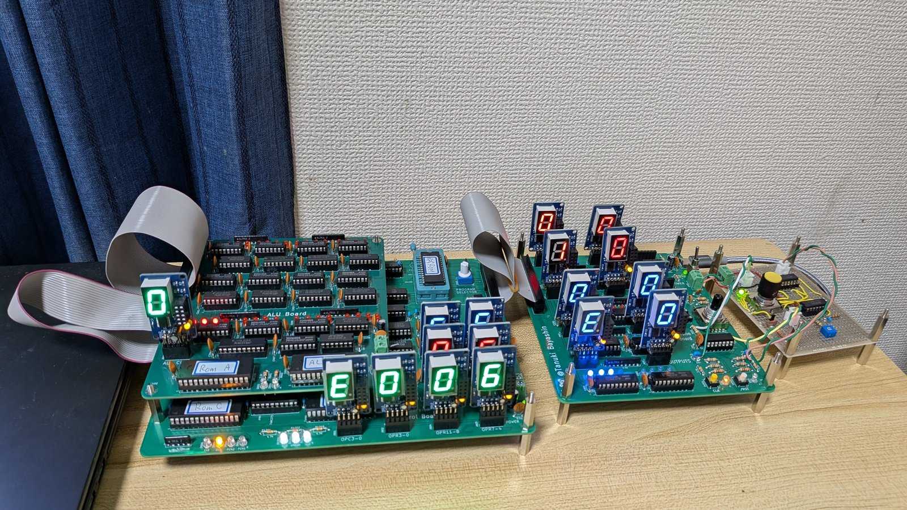

# TB-04

自作 4bit CPU **TB-04** のプロジェクトリポジトリです。
TD4 ライクなアーキテクチャをベースに、ALU とデコーダを ROM で実装した独自設計の 4bit CPU です。
データ幅は 4bit のまま、世代ごとにアドレス空間を広げています。



TB-04 ver2 の実機。左は演算板（上）と制御板（下）を重ねたもの、右は IF 板、右端はクロック供給ユニット clock4096。

回路図・PCB（KiCAD）とプログラム・ツール類を、世代ごとのディレクトリにまとめています。回路図は KiCAD がなくても見られるよう PDF も置いています（各 README からリンク）。

## 世代

| 世代 | アドレス | 状態 | 主な特徴 | ディレクトリ |
|---|---|---|---|---|
| **ver1** | 4bit（16語） | 完成（2026-06） | 16命令・レジスタ R0〜R3・基板1枚 | [`ver1/`](ver1/) |
| **ver2** | 8bit（256語） | 完成（2026-10） | 2語命令・34命令・レジスタ R0〜R7・RAM とスタック・基板3枚・7セグ表示17台 | [`ver2/`](ver2/) |
| ver3 | 12bit（予定） | 構想中 | ポインタ・間接アドレッシング | — |

いずれも 1命令＝4クロック（ディレイスロットなし）で動きます。
各世代の仕様・ファイル構成・使い方は、それぞれのディレクトリの README を参照してください。

## 周辺機器

周辺ユニットは [`peripherals/`](peripherals/) に置いています。7segIF は ver1・ver2 のどちらでも使え、clock4096 は ver2 用です。

| ユニット | 内容 |
|---|---|
| [`7segIF`](peripherals/7segIF/) | 4bit を `0`〜`F` の7セグメントで表示するユニット（CH32V003）。ver2 では17台を使用 |
| [`clock4096`](peripherals/clock4096/) | ver2 用のクロック供給ユニット（RC 発振 4096Hz ＋ 分周、ロータリースイッチで周波数を選択）。ユニバーサル基板で製作・回路図（KiCAD・PDF）を公開 |

## ディレクトリ構成

```
ver1/         アドレス 4bit 版（回路図・PCB・アセンブラ・シミュレータ・サンプルプログラム・Pico 簡易ロジックアナライザ）
ver2/         アドレス 8bit 版（回路図・PCB・シミュレータ・ROM 生成ツール・高速ロジックアナライザ）
peripherals/  周辺ユニット（7segIF＝ver1・ver2 共通／clock4096＝ver2 用）
```

KiCAD のバージョンは、ver1 が 9.0（ロジックアナライザのみ 10.0）、ver2・7segIF・clock4096 が 10.0 です。

## 資料

- 展示会の配布資料「これまでに製作した自作CPUについてのまとめ」（2026-08-08・PDF）: <https://drive.google.com/file/d/16cySft4IG1u6tpTtqwmJSpbO6KQHhh4Z/view?usp=drive_link>
  CPU のしくみの解説と、TB-01（1bit）・TB-02（2bit）・TD4・TB-04 ver1 の構成と命令表をまとめたものです。

## ライセンス

[MIT License](LICENSE)（回路図・PCB・プログラム・ドキュメントを含む）。
ただし 7segIF の回路図・基板（`peripherals/7segIF/hardware/`）は、CC BY-SA 4.0 の作品をもとにしているため CC BY-SA 4.0 です（[`peripherals/7segIF/LICENSE`](peripherals/7segIF/LICENSE)）。

## 関連記事

ver1
- 設計編「【TB-04】4bitCPUの設計」: <https://tanuki-bayashin.hatenablog.com/entry/2026/05/27/140048>
- 完成編「【TB-04】4bitCPUの完成（アドレス4bitバージョン）」: <https://tanuki-bayashin.hatenablog.com/entry/2026/06/20/164917>
- ソースコード編「【TB-04】4bitCPUのソースコード編（シリーズ完結）」: <https://tanuki-bayashin.hatenablog.com/entry/2026/06/25/220134>
- ロジックアナライザー編「ラズベリーパイPicoによる簡易ロジックアナライザー」: <https://tanuki-bayashin.hatenablog.com/entry/2026/06/28/074330>

ver2
- 設計編「【TB-04】4bitCPUの設計（addr 8bit ver）」: <https://tanuki-bayashin.hatenablog.com/entry/2026/11/03/164404>
- 回路図とPCB設計編「【TB-04】4bitCPUの回路図とPCB設計(addr 8bit ver)」: <https://tanuki-bayashin.hatenablog.com/entry/2026/11/05/082909>
- 完成編「【TB-04】4bitCPUの完成（addr 8bit ver）」: <https://tanuki-bayashin.hatenablog.com/entry/2026/11/07/110004>
- デモ動画: <https://www.youtube.com/watch?v=xa86bRDYqcg>

周辺機器
- 「【TB-04用】7SEG表示装置（16進）の製作」: <https://tanuki-bayashin.hatenablog.com/entry/2026/08/18/172152>
